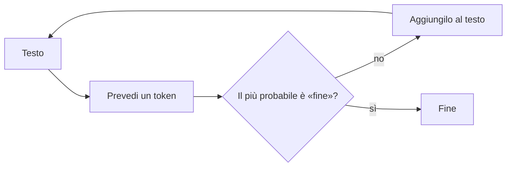
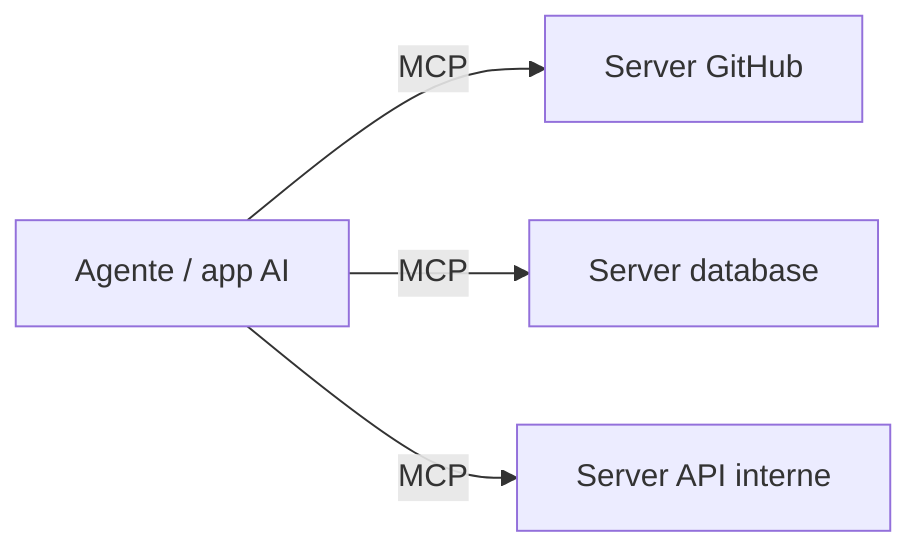
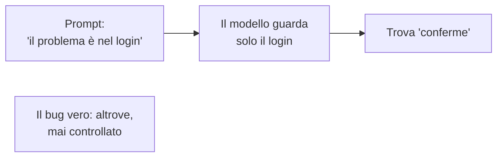

# Agentic AI

### Che cosa abbiamo imparato

<span class="muted">Roundtable sull'uso dell'AI in azienda</span>

Note: Obiettivo: capire cos'è un agente, come funziona dentro, quali trappole ha e vederne uno dal vivo.

---

## Di che cosa parleremo

<div class="path">
  <div><b>1</b>Overview</div>
  <div><b>2</b>Come funziona dentro</div>
  <div><b>3</b>Le trappole</div>
  <div><b>4</b>Un agente dal vivo</div>
  <div><b>5</b>Rischi e responsabilità</div>
</div>

---

# 1. Overview

<span class="muted">Che cos'è un agente</span>

<div class="path">
  <div class="here"><b>1</b>Overview</div>
  <div><b>2</b>Come funziona dentro</div>
  <div><b>3</b>Le trappole</div>
  <div><b>4</b>Un agente dal vivo</div>
  <div><b>5</b>Rischi e responsabilità</div>
</div>

---

## Overview: che cos'è un agente

<div class="cli-frame">
  <div class="cli-title">CLI · claude (di default)</div>
  <div class="agent">
    <div class="agent-io">Prompt</div>
    <div class="agent-arrow">→</div>
    <div class="agent-core">
      <div class="agent-title">Agente</div>
      <div class="agent-inner">
        <div class="agent-box focus llm">
          <div class="llm-title">Claude · un LLM</div>
          <div class="llm-step">Contesto<br><span class="muted">prompt, ragionamento, risultati</span></div>
          <div class="llm-down">↓</div>
          <div class="llm-step">Transformer<br><span class="muted">attention + strati</span></div>
          <div class="llm-down">↓</div>
          <div class="llm-step">Prossimo token</div>
          <div class="llm-back">↺ e torna nel contesto</div>
        </div>
        <div class="agent-loop">⇄</div>
        <div class="agent-box tools">
          <div class="tools-title">Strumenti</div>
          <div class="tool-chip">di default<br><span class="muted">Read · Edit · Bash</span></div>
          <div class="tool-chip built">costruiti da noi<br><span class="muted">CLI · MCP</span></div>
        </div>
      </div>
    </div>
    <div class="agent-arrow">→</div>
    <div class="agent-io out">Output<br><span class="muted">codice,<br>infrastruttura</span></div>
  </div>
</div>

---

## Stocastico e deterministico

<div class="cli-frame two">
  <div class="cli-title">CLI · claude (di default)</div>
  <div class="agent">
    <div class="agent-io">Prompt</div>
    <div class="agent-arrow">→</div>
    <div class="agent-core">
      <div class="agent-title">Agente</div>
      <div class="agent-inner">
        <div class="agent-box focus llm ring-a">
          <div class="ring-tag">stocastico</div>
          <div class="llm-title">Claude · un LLM</div>
          <div class="llm-step">Contesto<br><span class="muted">prompt, ragionamento, risultati</span></div>
          <div class="llm-down">↓</div>
          <div class="llm-step">Transformer<br><span class="muted">attention + strati</span></div>
          <div class="llm-down">↓</div>
          <div class="llm-step">Prossimo token</div>
          <div class="llm-back">↺ e torna nel contesto</div>
        </div>
        <div class="agent-loop">⇄</div>
        <div class="agent-box tools ring-b">
          <div class="ring-tag">deterministico</div>
          <div class="tools-title">Strumenti</div>
          <div class="tool-chip">di default<br><span class="muted">Read · Edit · Bash</span></div>
          <div class="tool-chip built">costruiti da noi<br><span class="muted">CLI · MCP</span></div>
        </div>
      </div>
    </div>
    <div class="agent-arrow">→</div>
    <div class="agent-io out">Output<br><span class="muted">codice,<br>infrastruttura</span></div>
  </div>
</div>

---

## Programmazione tradizionale

<div class="ml">
  <div class="ml-col">
    <div class="ml-box">Dati</div>
    <div class="ml-box focus">Programma</div>
  </div>
  <div class="agent-arrow">→</div>
  <div class="ml-box">Computer</div>
  <div class="agent-arrow">→</div>
  <div class="ml-box">Risultato</div>
</div>

Le regole le scrive un dev.

---

## Machine Learning

<div class="ml">
  <div class="ml-col">
    <div class="ml-box">Dati</div>
    <div class="ml-box">Risultati attesi</div>
  </div>
  <div class="agent-arrow">→</div>
  <div class="ml-box">Computer</div>
  <div class="agent-arrow">→</div>
  <div class="ml-box focus">Modello</div>
</div>

Le regole le trova la macchina dagli esempi.

---

## Workflow o agente?

| | Workflow | Agente |
|---|---|---|
| Chi decide i passi? | Il nostro codice | Il modello |
| Strumenti | Sequenza fissa | Scelti al momento |
| Ciclo | Predefinito | Fino all'obiettivo |
| Ideale per | Processi ripetibili | Compiti aperti |

---

## La definizione

> Un **agente** è un LLM che **usa strumenti in un ciclo** per raggiungere un **obiettivo**, decidendo da solo il passo successivo.

<div class="cols">
<div><span class="tag">LLM</span><br>ragiona e decide</div>
<div><span class="tag">Strumenti</span><br>agiscono sul mondo</div>
<div><span class="tag">Ciclo</span><br>osserva → corregge</div>
</div>

---

## Anatomia di un agente


---

## Il ciclo: pensa, agisce, osserva

<div class="seq">
  <div class="seq-row"><span class="who">Il nostro codice</span><span class="arr">→</span><span class="who ai">Claude</span><span class="msg">obiettivo + definizione strumenti</span></div>
  <div class="seq-loop">
    <div class="seq-label">ciclo, finché Claude chiede strumenti (<code>stop_reason: tool_use</code>)</div>
    <div class="seq-row"><span class="who ai">Claude</span><span class="arr">→</span><span class="who">Il nostro codice</span><span class="msg"><code>tool_use</code> (nome, input)</span></div>
    <div class="seq-row"><span class="who">Il nostro codice</span><span class="arr">→</span><span class="who">Strumento</span><span class="msg">esegue</span></div>
    <div class="seq-row"><span class="who">Strumento</span><span class="arr">→</span><span class="who">Il nostro codice</span><span class="msg">risultato</span></div>
    <div class="seq-row"><span class="who">Il nostro codice</span><span class="arr">→</span><span class="who ai">Claude</span><span class="msg"><code>tool_result</code></span></div>
  </div>
  <div class="seq-row"><span class="who ai">Claude</span><span class="arr">→</span><span class="who">Il nostro codice</span><span class="msg">risposta finale</span></div>
</div>

---

# 2. Come funziona dentro

<span class="muted">Il modello, il contesto, gli strumenti</span>

<div class="path">
  <div><b>1</b>Overview</div>
  <div class="here"><b>2</b>Come funziona dentro</div>
  <div><b>3</b>Le trappole</div>
  <div><b>4</b>Un agente dal vivo</div>
  <div><b>5</b>Rischi e responsabilità</div>
</div>

---

## Che cos'è un LLM

Un modello che prevede la parola successiva.

Tutto qui.

---

## Token: i pezzi del testo

Il modello non vede parole ma token.

`Il` · `gatto` · `dorm` · `e` · `sul` · `div` · `ano`

In media un token è circa ¾ di parola.

---

## Perché token e non parole?

<span class="muted">Un problema classico di NLP (Natural Language Processing)</span>

<div class="tok">
  <div class="tok-row bad">
    <div class="tok-label">Parole intere</div>
    <div class="tok-chips"><span>smartworkando</span></div>
    <div class="tok-note">✗ mai vista: sconosciuta</div>
  </div>
  <div class="tok-row bad">
    <div class="tok-label">Caratteri</div>
    <div class="tok-chips small"><span>s</span><span>m</span><span>a</span><span>r</span><span>t</span><span>w</span><span>o</span><span>r</span><span>k</span><span>a</span><span>n</span><span>d</span><span>o</span></div>
    <div class="tok-note">✗ 13 pezzi senza significato</div>
  </div>
  <div class="tok-row good">
    <div class="tok-label">Token</div>
    <div class="tok-chips"><span>smart</span><span>work</span><span>ando</span></div>
    <div class="tok-note">✓ 3 pezzi noti</div>
  </div>
</div>

<span class="muted">Esempio indicativo. Tecnica più diffusa: BPE (Byte Pair Encoding).</span>

---

## Tokenizer e training: un legame stretto

<div class="pipe">
  <div class="pipe-step">Tanti testi<br><span class="muted">di esempio</span></div>
  <div class="pipe-arrow">→</div>
  <div class="pipe-step focus">Vocabolario fisso<div class="tok-chips"><span>the</span><span>ing</span><span>gatto</span><span>ando</span><span>…</span></div></div>
  <div class="pipe-arrow">→</div>
  <div class="pipe-step">Training<br><span class="muted">del modello</span></div>
</div>

<div class="card solo">
  <div class="card-title">Ogni modello ha il suo <span class="muted">· esempi indicativi</span></div>
  <div class="tok-pair"><span class="tok-who">Modello A</span><div class="tok-chips"><span>get</span><span>User</span><span>ById</span></div><b>3</b></div>
  <div class="tok-pair"><span class="tok-who">Modello B</span><div class="tok-chips"><span>get</span><span>Us</span><span>er</span><span>By</span><span>Id</span></div><b>5</b></div>
  <div class="card-title sep">L'inglese costa meno</div>
  <div class="tok-pair"><span class="tok-who">Prompt EN</span><div class="tok-chips"><span>Fix</span><span>the</span><span>login</span><span>bug</span></div><b>4</b></div>
  <div class="tok-pair"><span class="tok-who">Prompt IT</span><div class="tok-chips"><span>Cor</span><span>reggi</span><span>il</span><span>bug</span><span>del</span><span>login</span></div><b>6</b></div>
</div>

<p class="below">Cambiare tokenizer = riaddestrare il modello.</p>

---

## E il cinese? Niente spazi, niente lettere

<div class="card solo">
  <div class="card-title">Dove finisce una parola? <span class="muted">· esempi indicativi</span></div>
  <div class="tok-pair"><span class="tok-who">Italiano</span><div class="tok-chips"><span>Il</span><span>gatto</span><span>dorme</span></div><b>3</b></div>
  <div class="tok-pair"><span class="tok-who">Cinese</span><div class="tok-chips"><span>猫</span><span>在</span><span>睡觉</span></div><b>3</b></div>
  <div class="card-title sep">Lo stesso prompt</div>
  <div class="tok-pair"><span class="tok-who">Prompt EN</span><div class="tok-chips"><span>Fix</span><span>the</span><span>login</span><span>bug</span></div><b>4</b></div>
  <div class="tok-pair"><span class="tok-who">Prompt ZH</span><div class="tok-chips"><span>修复</span><span>登录</span><span>错误</span></div><b>3</b></div>
  <div class="card-title sep">Carattere raro: si scende ai byte</div>
  <div class="tok-pair"><span class="tok-who">鱻</span><div class="tok-chips small"><span>E9</span><span>B1</span><span>BB</span></div><b>3</b></div>
</div>

<p class="below">Il training è identico: statistiche sui pezzi più frequenti. Cambia solo da dove si parte: byte, non lettere.</p>

---

## Prevedere il token successivo

*Il gatto dorme sul …*

| | |
|---|---|
| divano | 41% |
| letto | 23% |
| tetto | 12% |
| … | |

---

## Generare = ripetere



fino alla fine della risposta

<span class="muted">«Fine» è un token come gli altri: il modello l'ha imparato dai testi di esempio, che a un certo punto finiscono.</span>

---

## Parametri

Miliardi di numeri: i pesi.

Come le sinapsi del cervello.

---

## Le dimensioni

Cervello: circa 10<sup>15</sup> connessioni.

Grandi LLM: centinaia o migliaia di miliardi di parametri.

---

## Come impara un LLM

Legge trilioni di token: quasi tutto internet.

Indovina la parola dopo, sbaglia, corregge i pesi.

---

## Da modello ad assistente

<div class="pipe">
  <div class="pipe-step">Pre-training<br><span class="muted">leggere internet</span></div>
  <div class="pipe-arrow">→</div>
  <div class="pipe-step">Fine-tuning<br><span class="muted">esempi di dialogo</span></div>
  <div class="pipe-arrow">→</div>
  <div class="pipe-step focus">Feedback umano<br><span class="muted">risposte migliori</span></div>
</div>

---

## Temperatura

*Dai un nome a una funzione che somma due numeri*

<div class="card solo">
  <div class="card-title">Tre esecuzioni, stesso prompt <span class="muted">· esempio indicativo</span></div>
  <div class="tok-pair"><span class="tok-who">Bassa</span><div class="tok-chips"><span>sum</span><span>sum</span><span>sum</span></div></div>
  <div class="tok-pair"><span class="tok-who">Alta</span><div class="tok-chips"><span>add</span><span>computeTotal</span><span>plusPair</span></div></div>
</div>

Bassa: sceglie sempre la parola più probabile.

Alta: osa di più, più creativa e più errori.

<p class="below">Un nome preso dalla fisica: freddo = ordinato e prevedibile, caldo = agitato e imprevedibile.<br>La sceglie chi chiama il modello (parametro API), non chi chatta. Nei modelli Claude attuali non è più regolabile.</p>

---

## Temperatura ≠ effort

<div class="card solo">
  <div class="card-title">Temperatura: quanto osa <span class="muted">· esempio indicativo</span></div>
  <div class="tok-pair"><span class="tok-who">Prompt</span><div class="tok-chips"><span>sum</span><span>add</span><span>plusPair</span></div></div>
  <div class="card-title sep">Effort: quanto ragiona</div>
  <div class="tok-pair"><span class="tok-who">Basso</span><div class="tok-chips"><span>risponde</span></div></div>
  <div class="tok-pair"><span class="tok-who">Alto</span><div class="tok-chips"><span>ragiona</span><span>verifica</span><span>risponde</span></div></div>
</div>

<p class="below">Effort alto = più token e più tempo, non più fantasia. Su Claude l'effort si imposta (<code>output_config.effort</code>, da <code>low</code> a <code>max</code>). Per la maggior parte dei casi basta il default: su Opus 5.5 è <code>medium</code>. La temperatura no.</p>

---

## Prima e dopo

<div class="cols">
<div><span class="tag">Prima</span><br>una parola alla volta,<br>in fila</div>
<div><span class="tag">Transformer</span><br>tutte le parole insieme,<br>in parallelo</div>
</div>

---

## Embedding

Ogni token diventa una lista di numeri.

Parole simili → numeri vicini.

---

## Attention

Ogni parola guarda tutte le altre

e decide quali sono importanti per lei.

---

## Attention: un esempio

<div class="tok-chips center"><span>Il</span><span class="hl">gatto</span><span>non</span><span>salta</span><span>perché</span><span>è</span><span class="hl">stanco</span></div>

«stanco» si riferisce a «gatto».

---

## Query, Key, Value

<div class="pipe">
  <div class="pipe-step">Query<br><span class="muted">cosa cerco?</span></div>
  <div class="pipe-step">Key<br><span class="muted">cosa offro?</span></div>
  <div class="pipe-step">Value<br><span class="muted">cosa passo?</span></div>
</div>

Come in biblioteca: domanda, etichetta, contenuto.

---

## La matrice di attention

Si ricalcola a ogni domanda.

Dipende dal testo in ingresso.

---

## Teste multiple

Tante attention in parallelo.

Ognuna si specializza: grammatica, posizione, riferimenti.

---

## Strati

Decine di strati uno sopra l'altro.

Ogni strato raffina il significato.

---

## Il transformer in una slide

<div class="pipe center small">
  <div class="pipe-step">Testo</div>
  <div class="pipe-arrow">→</div>
  <div class="pipe-step">Token</div>
  <div class="pipe-arrow">→</div>
  <div class="pipe-step">Embedding</div>
  <div class="pipe-arrow">→</div>
  <div class="pipe-step focus">Attention<br><span class="muted">+ strati ×N</span></div>
  <div class="pipe-arrow">→</div>
  <div class="pipe-step">Prossimo<br>token</div>
</div>

---

## Ragionare è scrivere nel contesto

<div class="card solo">
  <div class="card-title">Tutto passa dal contesto <span class="muted">· esempio indicativo</span></div>
  <div class="tok-pair"><span class="tok-who">Domanda</span><div class="tok-chips"><span>perché fallisce il test?</span></div></div>
  <div class="tok-pair"><span class="tok-who">Ragiona</span><div class="tok-chips"><span>restituisce null</span><span>quindi…</span></div></div>
  <div class="tok-pair"><span class="tok-who">Risposta</span><div class="tok-chips"><span>manca un controllo</span></div></div>
</div>

Il ragionamento è testo come gli altri: ogni parola entra nel contesto e viene riletta per prevedere la successiva.

<p class="below">Più il modello ragiona, più contesto occupa.</p>

---

## Finestra di contesto

La memoria di lavoro del modello.

<div class="ctx">
  <div class="ctx-outside">…</div>
  <div class="ctx-window">
    <div>istruzioni</div>
    <div>documenti</div>
    <div>conversazione</div>
    <div>risposta</div>
  </div>
</div>

Quello che non ci sta, il modello non lo vede.

---

## Niente memoria tra conversazioni

Ogni chat riparte da zero.

Salvo strumenti che gli ridanno il contesto.

<span class="muted">Esempio: Claude Code carica `CLAUDE.md` all'inizio di ogni sessione.</span>

---

## Il contesto costa

| | |
|---|---|
| 1.000 token | 1 milione di confronti |
| 10.000 token | 100 milioni |
| 100.000 token | 10 miliardi |

Raddoppi il testo, quadruplichi il lavoro.

---

## Esempio

**"Quanti ordini aperti ci sono?"**

Pensa: serve una query sul DB

Agisce: `SELECT COUNT(*) …`

Osserva: 42

**"Ci sono 42 ordini aperti."**

---

## L'LLM non esegue niente

Scrive quale strumento usare.

Il programma lo esegue e gli ridà il risultato.

---

## Uno strumento è uno schema + una funzione

```python
@beta_tool
def aggregate_csv(name: str, group_by: str, value_column: str) -> str:
    """Somma una colonna numerica di un CSV, raggruppando per un'altra colonna.

    Args:
        name: nome del file CSV nella cartella di lavoro.
        group_by: colonna per cui raggruppare, es. regione.
        value_column: colonna numerica da sommare, es. ricavi_eur.
    """
    ...
```

Il modello vede solo **nome**, **descrizione** e **parametri**.<br>
<span class="muted">Scrivere buone descrizioni degli strumenti è il nuovo prompt engineering.</span>

---

## Pattern di progettazione

<div class="cols">
<div>

**Workflow**
- Catena di prompt
- Instradamento (routing)
- Parallelizzazione
- Valutatore–ottimizzatore

</div>
<div>

**Agenti**
- ReAct: ragiona → agisce → osserva
- Pianificazione + esecuzione
- Orchestratore + sotto-agenti
- Persona nel ciclo (human in the loop)

</div>
</div>

<span class="muted">Si parte dalla soluzione più semplice: una chiamata → un workflow → un agente.</span>

---

## Collegare gli strumenti: MCP



**MCP**: un'integrazione, ogni client.

---

# 3. Le trappole

### Anche l'agente usa euristiche

<div class="path">
  <div><b>1</b>Overview</div>
  <div><b>2</b>Come funziona dentro</div>
  <div class="here"><b>3</b>Le trappole</div>
  <div><b>4</b>Un agente dal vivo</div>
  <div><b>5</b>Rischi e responsabilità</div>
</div>

---

## Confabulazioni <span class="muted">(le chiamano allucinazioni)</span>

Una risposta convincente ma falsa.

```csharp
if (string.IsNullOrBlank(nome)) return;   // non esiste in .NET
```

<span class="muted">Esempio: il metodo vero è `string.IsNullOrWhiteSpace`. Il nome inventato è plausibile, quindi convince.</span>

---

## Perché succede

Il modello completa con ciò che è probabile,

invece di dire «non so».

<span class="muted">Per questo: verifica.</span>

---

## Più la chat è lunga, peggio va

<div class="ctx">
  <div class="ctx-outside">…</div>
  <div class="ctx-window">
    <div class="fade">istruzioni</div>
    <div class="fade">vecchi messaggi</div>
    <div>messaggi recenti</div>
    <div>risposta</div>
  </div>
</div>

Il modello perde dettagli e confonde le cose.

<p class="below">Esempio: dopo ore di lavoro, una regola data all'inizio non viene più rispettata. Compattare = riassumere le parti vecchie per continuare.</p>

---

## Razionalità limitata

Non possiamo elaborare tutte le informazioni.

Non possiamo prevedere tutti i risultati.

<span class="muted">Herbert Simon – Nobel per l'economia 1978</span>

---

## Come si progetta un sistema AI?

<div class="cols">
<div><span class="tag">Risorse scarse</span><br>Un sistema AI lavora quasi sempre con dati limitati. Non vede tutto quello che succede.</div>
<div><span class="tag">Euristiche</span><br>Regole pratiche per decidere senza sapere tutto.</div>
<div><span class="tag">Satisficing</span><br>Una soluzione sufficiente invece della migliore.</div>
</div>

---

## Bug Fix

Una variante dell'ancoraggio: l'ancora è la nostra opinione.

> "Penso che il problema nel mio codice sia nella funzione di login, puoi controllare?"

Il modello rischia di concentrarsi lì e trovare "conferme", anche se il bug è altrove.

---

## Dove guarda il modello



---

## Ancoraggio + compiacenza

<div class="cols">
<div><span class="tag">Ancoraggio</span><br>parte dalla tua ipotesi</div>
<div><span class="tag">Compiacenza</span><br>tende a darti ragione</div>
</div>

Una risposta che conferma quello che pensavi già.

---

## L'ancora pericolosa non è quella assurda, che il modello smaschera.

È quella credibile, che sposta la risposta senza che nessuno se ne accorga.

---

## Lisca di pesce (Ishikawa)

Kaoru Ishikawa, controllo qualità, anni '60: prima tutte le cause possibili, poi si verifica.

<svg class="fishbone" viewBox="0 0 1100 400" role="img" aria-label="Lisca di pesce: sei cause portano all'effetto">
  <defs><marker id="fb-arrow" viewBox="0 0 10 10" refX="9" refY="5" markerWidth="5" markerHeight="5" orient="auto"><path class="arrowhead" d="M0,0 L10,5 L0,10 z"/></marker></defs>
  <path class="tail" d="M20,140 L80,200 L20,260 z"/>
  <line class="spine" x1="80" y1="200" x2="835" y2="200" marker-end="url(#fb-arrow)"/>
  <line class="bone" x1="185" y1="70" x2="280" y2="200"/>
  <g class="cause"><rect x="125" y="20" width="120" height="50" rx="10"/><text x="185" y="54" text-anchor="middle">Codice</text></g>
  <line class="bone" x1="185" y1="330" x2="280" y2="200"/>
  <g class="cause"><rect x="140" y="330" width="90" height="50" rx="10"/><text x="185" y="364" text-anchor="middle">Dati</text></g>
  <line class="bone" x1="425" y1="70" x2="520" y2="200"/>
  <g class="cause"><rect x="305" y="20" width="240" height="50" rx="10"/><text x="425" y="54" text-anchor="middle">Configurazione</text></g>
  <line class="bone" x1="425" y1="330" x2="520" y2="200"/>
  <g class="cause"><rect x="350" y="330" width="150" height="50" rx="10"/><text x="425" y="364" text-anchor="middle">Ambiente</text></g>
  <line class="bone" x1="665" y1="70" x2="760" y2="200"/>
  <g class="cause"><rect x="575" y="20" width="180" height="50" rx="10"/><text x="665" y="54" text-anchor="middle">Dipendenze</text></g>
  <line class="bone" x1="665" y1="330" x2="760" y2="200"/>
  <g class="cause"><rect x="538" y="330" width="255" height="50" rx="10"/><text x="665" y="364" text-anchor="middle">Servizi esterni</text></g>
  <g class="head"><rect x="845" y="140" width="240" height="120" rx="16"/><text x="965" y="192" text-anchor="middle">Effetto:</text><text x="965" y="230" text-anchor="middle">il login fallisce</text></g>
</svg>

La nostra ipotesi diventa una lisca tra le altre, non la risposta.

---

## Passo 1 – Estrazione

<div class="prompt">

Dal ticket seguente separa:

- FATTI OSSERVATI (cosa è successo, quando, a chi, messaggi d'errore)
- IPOTESI O VALUTAZIONI di chi ha scritto il ticket

Non proporre ancora cause né soluzioni.

[testo del ticket]

</div>

---

## Passo 2 – Diagnosi

<div class="prompt">

Partendo solo dai fatti osservati qui sotto, elenca almeno 4 cause possibili, indipendenti tra loro. Per ciascuna indica quale verifica concreta (log, query, test) la confermerebbe o la escluderebbe.
Solo alla fine confronta le cause con l'ipotesi del service desk.

[fatti estratti]<br>
[log / stack trace / diff dell'ultimo deploy]

</div>

---

## Euristica della familiarità

> "Ne ho già sentito parlare, quindi è migliore."

<div class="cols">
<div>

Prompt: "Serializza l'ordine in JSON."

```csharp
using Newtonsoft.Json;
JsonConvert.SerializeObject(ordine);
```

✓ La più vista in addestramento

</div>
<div>

Scegliamo quello che riconosciamo.

Nel codice: il modello propone la libreria che ha visto più spesso, non quella del progetto.

Il repo usa già System.Text.Json: ora ci sono due librerie per la stessa cosa.

</div>
</div>

---

## Satisficing

> "Va bene così."

<div class="cols">
<div>

✗ Test rosso<br>
NullReferenceException in CalcolaGiacenza

```csharp
try { CalcolaGiacenza(udc); }
catch { }
```

✓ Build verde: va bene così

</div>
<div>

Una soluzione sufficiente invece della migliore.

Nel codice: il test diventa verde, la causa resta.

La soluzione migliore, mai cercata: perché udc è null? La causa è nella query che la carica.

</div>
</div>

---

## Anche l'AI usa euristiche

Decide con regole pratiche, come noi.

E come noi eredita i pregiudizi dai dati.

---

# 4. Un agente dal vivo

### Claude Code al lavoro

<div class="path">
  <div><b>1</b>Overview</div>
  <div><b>2</b>Come funziona dentro</div>
  <div><b>3</b>Le trappole</div>
  <div class="here"><b>4</b>Un agente dal vivo</div>
  <div><b>5</b>Rischi e responsabilità</div>
</div>

---

## Claude Code

Un agente che lavora sul codice e sui file.

Legge, cerca, modifica, esegue test.

<span class="muted">Le demo di oggi usano Claude Code in modalità non interattiva: `claude -p`.</span>

---

## Il contesto del progetto: CLAUDE.md

Un file che spiega all'agente il progetto.

- com'è fatto il progetto
- regole e convenzioni
- come si compila e si testa

---

## CLAUDE.md: un esempio

```markdown
# Agentic AI – presentazione

Slide reveal.js in italiano generate da `slides/slides.md` con mkslides;
demo live in `demo/`.
Regole di dettaglio in `.claude/rules/` (slide e demo).

- `make build` e `make test` devono passare prima di ogni commit.
- `.env` non va mai committato.
```

<span class="muted">Il CLAUDE.md di questo progetto. Altri file si importano con `@percorso`. Meglio restare sotto le 200 righe.</span>

---

## Tieni la configurazione essenziale

<div class="live" data-demo="7"><code class="live-cmd-src">claude -p "…" --tools ""</code><span class="live-prompt-src">Rivedi questo CLAUDE.md e dimmi cosa è obsoleto, doppio o contraddittorio, una riga per voce. 1) Usa .NET 6. 2) Il progetto usa .NET 10. 3) Scrivi commenti ovunque. 4) Non scrivere commenti inutili. 5) Per il deploy usa lo script Jenkins (dismesso a marzo). 6) Rispondi in italiano. 7) Rispondi sempre in italiano. Rispondi solo con l'elenco.</span></div>

<p class="below">Il CLAUDE.md viene caricato a ogni sessione: ogni regola vecchia costa token e può confondere il modello. Rivedilo ogni tanto.</p>

---

## Un secondo cervello

<div class="card solo">
  <div class="card-title">Una cartella di testo <span class="muted">· esempio indicativo</span></div>
  <div class="tok-pair"><span class="tok-who">Progetto</span><div class="tok-chips"><span>stack.md</span><span>decisioni.md</span><span>ruoli.md</span></div></div>
  <div class="tok-pair"><span class="tok-who">Squadra</span><div class="tok-chips"><span>convenzioni.md</span><span>storico.md</span></div></div>
</div>

Il contesto su di te e sul tuo lavoro, sempre a disposizione.

<p class="below">Senza, ogni sessione riparte da zero e tu spieghi, copi e incolli. Con una cartella di file che Claude può leggere, ogni risposta parte dal contesto giusto. Per una squadra, il Claude di ognuno conosce subito come lavora l'azienda.</p>

---

## Regole per percorso: .claude/rules/

```markdown
---
paths:
  - "slides/**"
---

# Regole per le slide

- Chiare, brevi e concise. Un solo messaggio per slide.
- Esempi concreti, sempre.
```

Si carica solo quando Claude lavora su file che corrispondono a `paths`.<br>
<span class="muted">Senza `paths`, la regola si carica a ogni sessione come CLAUDE.md.</span>

---

## La cartella .claude

| | |
|---|---|
| `agents/` | agenti specializzati |
| `commands/` | comandi personalizzati |
| `skills/` | procedure riutilizzabili |
| `settings.json` | permessi e regole |

---

## La cartella .claude nella documentazione

```text
progetto/
├── CLAUDE.md
└── .claude/
    ├── settings.json          # permessi e hook, condiviso nel repo
    ├── settings.local.json    # preferenze personali, fuori da git
    ├── rules/*.md             # regole, anche per percorso
    ├── skills/<nome>/SKILL.md # procedure, si lanciano con /nome
    ├── agents/<nome>.md       # sotto-agenti specializzati
    └── commands/<nome>.md     # formato precedente delle skill
```

<span class="muted">Le stesse cartelle esistono in `~/.claude/` per le impostazioni personali.</span>

---

## Sii più ambizioso

<div class="card solo">
  <div class="card-title">Stesso lavoro, due modi di chiederlo <span class="muted">· esempio indicativo</span></div>
  <div class="tok-pair"><span class="tok-who">Prima</span><div class="tok-chips"><span>controller</span><span>test</span><span>doc</span></div></div>
  <div class="tok-pair"><span class="tok-who">Ora</span><div class="tok-chips"><span>migra l'endpoint, test verdi</span></div></div>
</div>

I modelli recenti sono addestrati a eseguire compiti lunghi dall'inizio alla fine.

<p class="below">Prima: tre prompt, supervisione a ogni passo. Ora: un incarico solo. Per i compiti complessi si può aggiungere una riga al prompt: «sii ambizioso». Il modello tende a costruire il minimo indispensabile.</p>

---

## Un brief, non un prompt

<div class="card solo">
  <div class="card-title">Come a un membro del team <span class="muted">· esempio indicativo</span></div>
  <div class="tok-pair"><span class="tok-who">Compito</span><div class="tok-chips"><span>migra /orders a .NET 10</span></div></div>
  <div class="tok-pair"><span class="tok-who">Perché</span><div class="tok-chips"><span>il runtime attuale scade</span></div></div>
  <div class="tok-pair"><span class="tok-who">Limiti</span><div class="tok-chips"><span>non toccare lo schema del DB</span></div></div>
  <div class="tok-pair"><span class="tok-who">Finito</span><div class="tok-chips"><span>test verdi, nessun warning</span></div></div>
</div>

<p class="below">Il «perché» aiuta il modello nelle piccole decisioni. «Finito» evita che continui a lavorare e a consumare token.</p>

---

## Idee confuse? Fatti intervistare

<div class="pipe">
  <div class="pipe-step">Brain dump<br><span class="muted">alla rinfusa</span></div>
  <div class="pipe-arrow">→</div>
  <div class="pipe-step focus">Domande<br><span class="muted">una alla volta</span></div>
  <div class="pipe-arrow">→</div>
  <div class="pipe-step">Brief<br><span class="muted">le quattro parti</span></div>
</div>

<div class="live" data-demo="8" data-out="150"><code class="live-cmd-src">claude -p "…" --tools ""</code><span class="live-prompt-src">Voglio un report sulle vendite per il direttore. Intervistami una domanda alla volta su qualsiasi cosa sia ambigua: fai solo la prima domanda.</span></div>

<p class="below">Spesso il limite non è cosa sa fare l'IA, ma quanto bene spieghi quello che vuoi.</p>

---

## Rendi l'output visivo

<div class="live" data-demo="4"><code class="live-cmd-src">claude -p "…" --tools ""</code><span class="live-prompt-src">Confronta REST e GraphQL: una tabella di tre righe, niente altro testo.</span></div>

<p class="below">Prova tu: cambia il prompt e chiedi lo stesso in prosa. Quanto ci metti a leggerlo?</p>

---

## Chiedi cinque opzioni, non una

<div class="live" data-demo="5"><code class="live-cmd-src">claude -p "…" --tools ""</code><span class="live-prompt-src">Dammi cinque nomi per un servizio che sincronizza gli ordini con il magazzino, uno per riga.</span></div>

<p class="below">Scegliere costa meno che correggere: con cinque opzioni, una è più vicina a ciò che vuoi.</p>

---

## Riavvolgi, non correggere

<div class="card solo">
  <div class="card-title">Estrai i clienti che hanno disdetto <span class="muted">· esempio indicativo</span></div>
  <div class="tok-pair"><span class="tok-who">Correggere</span><div class="tok-chips"><span>prompt</span><span>errore</span><span>correzione</span><span>…</span></div></div>
  <div class="tok-pair"><span class="tok-who">Riavvolgere</span><div class="tok-chips"><span>prompt + regola</span></div></div>
</div>

Ogni correzione allunga la chat e lascia l'errore nel contesto.

<p class="below">Esempio: l'estrazione conta anche gli abbonamenti passati. Si torna al primo prompt e si aggiunge: «conta solo gli abbonamenti cancellati».</p>

---

## Come si riavvolge: /rewind

```text
/rewind        (alias: /undo)
Esc Esc        (a prompt vuoto)
```

<div class="card solo">
  <div class="card-title">Il menu <span class="muted">· checkpointing, dalla documentazione</span></div>
  <div class="tok-pair"><span class="tok-who">Codice e chat</span><div class="tok-chips"><span>Restore code and conversation</span></div></div>
  <div class="tok-pair"><span class="tok-who">Solo chat</span><div class="tok-chips"><span>Restore conversation</span></div></div>
  <div class="tok-pair"><span class="tok-who">Solo codice</span><div class="tok-chips"><span>Restore code</span></div></div>
</div>

<p class="below">Il prompt scelto torna nella casella, da modificare e rinviare. Non sostituisce Git: le modifiche fatte dai comandi bash non sono tracciate.</p>

---

## Compatta prima che la chat peggiori

```text
/context                          quanto contesto è usato
/compact focus on the auth bug    riassume, tenendo il focus
/autocompact 400k                 compatta da solo a quella soglia
```

<p class="below">Di default Claude compatta solo quando il contesto è quasi pieno (circa 967K token su una finestra da 1M): prima, la chat può già peggiorare. Per cambiare lavoro conviene <code>/clear</code>.</p>

---

## Compattare non è comprimere

<div class="card solo">
  <div class="card-title">Due modi di accorciare <span class="muted">· esempio indicativo</span></div>
  <div class="tok-pair"><span class="tok-who">Zip</span><div class="tok-chips"><span>stesso testo, senza perdite</span></div></div>
  <div class="tok-pair"><span class="tok-who">/compact</span><div class="tok-chips"><span>un riassunto scritto dal modello</span></div></div>
</div>

Un riassunto sceglie cosa tenere: un dettaglio può sparire.

<p class="below">Per questo <code>/compact</code> accetta istruzioni su cosa conservare. Dopo la compattazione, <code>CLAUDE.md</code> viene ricaricato da disco: ciò che deve restare sempre va lì.</p>

---

## Chat calda, chat fredda

<div class="card solo">
  <div class="card-title">Quanto dura la cache <span class="muted">· Claude Code</span></div>
  <div class="tok-pair"><span class="tok-who">Abbonamento</span><div class="tok-chips"><span>1 ora</span></div></div>
  <div class="tok-pair"><span class="tok-who">Chiave API</span><div class="tok-chips"><span>5 minuti</span></div></div>
  <div class="card-title sep">Calda o fredda</div>
  <div class="tok-pair"><span class="tok-who">Calda</span><div class="tok-chips"><span>legge la copia, 1/20 del prezzo</span></div></div>
  <div class="tok-pair"><span class="tok-who">Fredda</span><div class="tok-chips"><span>rielabora tutta la chat</span></div></div>
</div>

<p class="below">Torni dopo una pausa lunga: il primo messaggio è più lento e più costoso. <code>/usage</code> dice se la cache è calda o fredda. Il 1/20 vale per Opus 5.5.</p>

---

## Una domanda a margine: /btw

```text
/btw come si chiamava il file di configurazione?
```

<div class="card solo">
  <div class="card-title">Cosa fa <span class="muted">· dalla documentazione</span></div>
  <div class="tok-pair"><span class="tok-who">Vede</span><div class="tok-chips"><span>tutta la conversazione</span></div></div>
  <div class="tok-pair"><span class="tok-who">Strumenti</span><div class="tok-chips"><span>nessuno</span></div></div>
  <div class="tok-pair"><span class="tok-who">Cronologia</span><div class="tok-chips"><span>la risposta non ci entra</span></div></div>
</div>

<p class="below">Si usa mentre Claude lavora, senza interromperlo. Per scoprire qualcosa di nuovo serve invece un sotto-agente. Sul desktop: Ctrl+; (Cmd+; su Mac).</p>

---

## Una skill: .claude/skills/release-notes/SKILL.md

```markdown
---
name: release-notes
description: Scrive le note di rilascio dai commit dall'ultimo tag
disable-model-invocation: true
---

1. Elenca i commit dall'ultimo tag con `git log`.
2. Raggruppa in: Novità, Correzioni, Breaking change.
3. Una riga per voce, con il riferimento al ticket.
```

Si lancia con `/release-notes`.<br>
<span class="muted">`disable-model-invocation: true`: parte solo se la chiamiamo noi.</span>

---

## Una skill dal lavoro reale

<div class="live" data-demo="6"><code class="live-cmd-src">claude -p "…" --tools ""</code><span class="live-prompt-src">Ecco tre note di rilascio che mi sono piaciute. 1) Novità: filtro per data negli ordini (#412). Correzioni: IVA arrotondata male (#398). 2) Novità: export CSV dei clienti (#420). Breaking change: rimosso /v1/orders (#431). 3) Correzioni: timeout sul login (#405). Novità: tema scuro (#415). Ricava il file SKILL.md di una skill (frontmatter con name e description, poi le istruzioni) che ne produca di simili dai commit. Rispondi solo con il contenuto del file, senza salvarlo.</span></div>

<p class="below">Le skill migliori nascono da lavoro già fatto: dagli esempi che ti sono piaciuti, o dopo averlo svolto insieme a Claude. In Cowork su Mac si può anche registrare («Record a skill»).</p>

---

## Un sotto-agente: .claude/agents/code-reviewer.md

```markdown
---
name: code-reviewer
description: Revisiona il codice per qualità e buone pratiche
tools: Read, Glob, Grep
model: sonnet
---

Sei un revisore di codice. Analizza il codice e dai indicazioni
precise e concrete su qualità, sicurezza e buone pratiche.
```

Lavora in un contesto separato, con i suoi strumenti: qui solo lettura.

---

## Più sotto-agenti, contesto pulito

<div class="pipe">
  <div class="pipe-step">Chat principale<br><span class="muted">resta pulita</span></div>
  <div class="pipe-arrow">→</div>
  <div class="pipe-step focus">Sotto-agenti<br><span class="muted">leggono molto</span></div>
  <div class="pipe-arrow">→</div>
  <div class="pipe-step">Riassunto<br><span class="muted">solo quello</span></div>
</div>

```text
model: haiku      # in .claude/agents/<nome>.md
```

<p class="below">Ogni sotto-agente ha il suo contesto e restituisce solo il riassunto finale. Per leggere e cercare bastano i modelli economici: se non lo scrivi, usa lo stesso modello della conversazione. Esempio di prompt: «analizza le 500 proposte con 100 sotto-agenti da cinque ciascuno».</p>

---

## Projects: un coordinatore, tanti thread

<div class="card solo">
  <div class="card-title">Un progetto coordina <span class="muted">· esempio indicativo</span></div>
  <div class="tok-pair"><span class="tok-who">Tu</span><div class="tok-chips"><span>migra il modulo ordini</span></div></div>
  <div class="tok-pair"><span class="tok-who">Thread</span><div class="tok-chips"><span>endpoint</span><span>test</span><span>documentazione</span></div></div>
</div>

<p class="below">Il progetto avvia un thread per ogni compito. I thread girano in parallelo e condividono repository, istruzioni e memoria. Public beta su Pro, Max e Ultra (non su Team ed Enterprise).</p>

---

## Permessi

L'agente chiede prima di fare azioni importanti.

Siamo noi a decidere cosa può fare da solo.

<span class="muted">Nelle demo: `--tools Read,Glob,Grep --allowedTools "Read(./**)"`</span>

---

## Permessi: .claude/settings.json

```json
{
  "permissions": {
    "allow": [
      "Bash(make build)",
      "Bash(make test)"
    ],
    "deny": [
      "Read(./.env)",
      "Read(./.env.*)"
    ]
  }
}
```

`allow`: senza chiedere · `ask`: chiede sempre · `deny`: mai.

---

## Hook: azioni che avvengono sempre

```json
{
  "hooks": {
    "PostToolUse": [
      {
        "matcher": "Edit|Write",
        "hooks": [{ "type": "command",
          "command": "f=$(jq -r '.tool_input.file_path') && npx prettier --write --ignore-unknown \"$f\"" }]
      }
    ]
  }
}
```

Dopo ogni modifica a un file, Claude Code lancia il formattatore.<br>
<span class="muted">Non decide il modello: lo garantisce il programma.</span>

---

# Demo dal vivo

<span class="muted">make demo1 · make demo2 · make demo3</span>

---

## Demo 1 — una singola chiamata

<div class="live" data-demo="1"><code class="live-cmd-src">claude -p "…" --tools ""</code><span class="live-prompt-src">Spiega in tre brevi punti cos'è la finestra di contesto di un LLM.</span></div>

Un prompt entra, una risposta esce. **Nessuno strumento, nessun ciclo.**

---

## Demo 2 — l'uso di uno strumento

<div class="live" data-demo="2"><code class="live-cmd-src">cd demo/store &amp;&amp; claude -p "…" --tools Read --allowedTools "Read(./**)"</code><span class="live-prompt-src">Buongiorno, sono il signor Rossi. Dove sono i miei ordini e quando arriveranno? Il database degli ordini è orders.json.</span></div>

Claude **chiede** lo strumento `Read`, il programma lo **esegue** e gli ridà il risultato.

---

## Dietro le quinte — il ciclo nel codice

```python
while True:
    response = client.messages.create(..., tools=TOOLS, messages=messages)
    tool_calls = [b for b in response.content if b.type == "tool_use"]
    if not tool_calls:
        break                                   # risposta finale
    messages.append({"role": "assistant", "content": response.content})
    messages.append({"role": "user", "content": [
        {"type": "tool_result", "tool_use_id": c.id, "content": run(c)}
        for c in tool_calls
    ]})
```

È quello che Claude Code (o il tool runner dell'SDK) fa per noi.

---

## Demo 3 — un agente autonomo

<div class="live" data-demo="3"><code class="live-cmd-src">cd demo/workspace &amp;&amp; claude -p "…" --tools Read,Glob,Grep --allowedTools "Read(./**)" Glob Grep</code><span class="live-prompt-src">Cerca in questa cartella una richiesta del direttore commerciale e portala a termine.</span></div>

<span class="muted">Solo lettura: `report.md` si salva solo se una persona approva.</span>

---

# 5. Rischi e responsabilità

<div class="path">
  <div><b>1</b>Overview</div>
  <div><b>2</b>Come funziona dentro</div>
  <div><b>3</b>Le trappole</div>
  <div><b>4</b>Un agente dal vivo</div>
  <div class="here"><b>5</b>Rischi e responsabilità</div>
</div>

---

## Rischi e guardrail

| Rischio | Mitigazione |
|---|---|
| Azioni sbagliate o distruttive | Strumenti col minimo privilegio, sandbox, approvazioni |
| Prompt injection dai dati | Trattare l'output degli strumenti come dati, non istruzioni |
| Costi e cicli senza fine | Limiti di turni, budget, livello di "effort" |
| Numeri inventati | Strumenti deterministici per i calcoli esatti |
| Dati che escono dall'azienda | Scegliere cosa entra nel contesto, policy chiare |
| Difficile da capire cosa è successo | Tracciare ogni chiamata a strumento, valutazioni (eval) |

---

## Quando costruire un agente?

- Il compito è **complesso** e difficile da specificare in anticipo?
- Il risultato **vale** il costo e il tempo in più?
- Il modello è **capace** di questo tipo di compito?
- Gli **errori si possono intercettare** e correggere?

<span class="muted">Se anche una sola risposta è "no": una singola chiamata o un workflow.</span>

---

## I limiti

Sbaglia, a volte con sicurezza.

Costa: ogni token si paga.

I dati che gli diamo escono dall'azienda.

---

## Cosa non delegare

Decisioni e responsabilità.

Rilasci senza controllo.

Dati dei clienti senza verifica.

---

## La responsabilità resta nostra

L'agente propone, la persona decide.

---

## Da dove iniziare

1. Scegliere un compito ripetitivo e con più passaggi
2. Esporre le API esistenti come strumenti (o server MCP)
3. All'inizio, una persona approva ogni azione
4. Misurare con un piccolo insieme di casi di prova, poi aumentare l'autonomia

---

> "Tutti i modelli sono sbagliati, ma alcuni sono utili."

<span class="muted">— George E. P. Box</span>

---

# Grazie

### Domande?

<span class="muted">Codice e slide: github.com/janmaru/ai-agentic</span>
