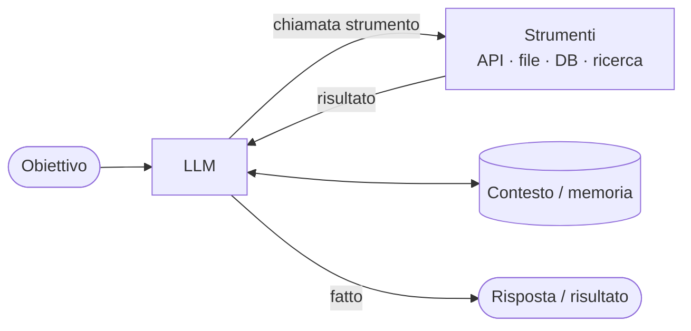
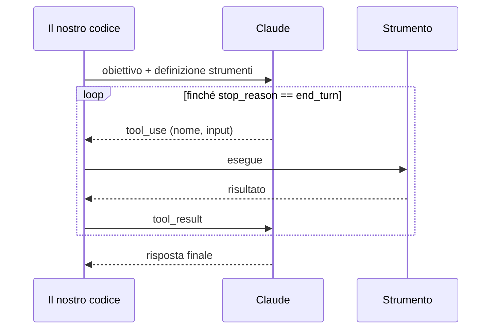
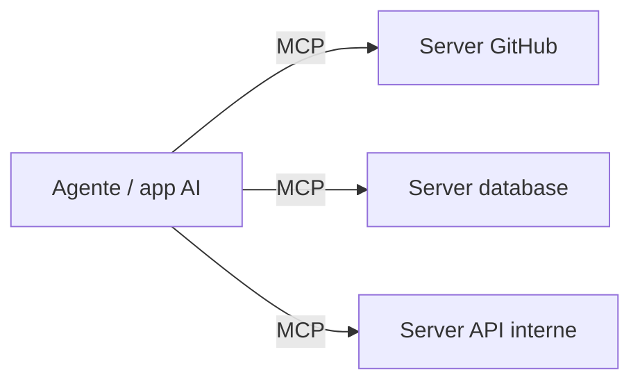
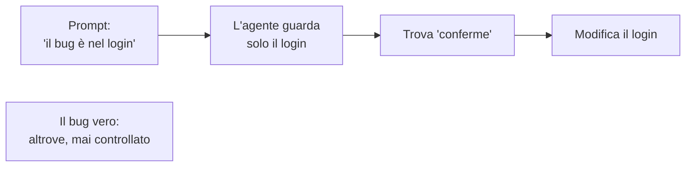

# Agentic AI

### Dall'assistente che risponde all'assistente che agisce

<span class="muted">Blexin · 2026</span>

Note: Obiettivo: capire cos'è un agente, come funziona dentro, quali trappole ha e vederne uno dal vivo.

---

## Di che cosa parleremo

1. Come ragiona un LLM, in breve
2. Dal chatbot all'agente
3. Le trappole: anche l'agente usa euristiche
4. Claude Code: un agente al lavoro
5. Demo dal vivo
6. Rischi, guardrail e responsabilità

---

# 1. Come ragiona un LLM

<span class="muted">Quello che serve sapere per capire un agente</span>

---

## Un LLM prevede il token successivo

<div class="cols">
<div>

*Il gatto dorme sul …*

| Token | Probabilità |
|---|---|
| divano | 41% |
| letto | 23% |
| tetto | 12% |

</div>
<div>

- Il modello vede **token**, non parole (≈ ¾ di parola)
- Genera ripetendo: prevede un token, lo aggiunge, ricomincia
- **Temperatura**: bassa = prevedibile, alta = creativa e più errori

</div>
</div>

Note: Tutto qui: un LLM è un modello statistico del testo. L'agente è costruito sopra questo meccanismo.

---

## Allucinazioni

> Il modello cerca ciò che è **probabile**, non ciò che è **vero**.

Una risposta convincente ma falsa.<br>
<span class="muted">In un chatbot è una frase sbagliata. In un agente può diventare un'azione sbagliata.</span>

---

## La finestra di contesto

<div class="cols">
<div>

La **memoria di lavoro** del modello:

- istruzioni
- documenti
- conversazione
- risultati degli strumenti

Quello che non ci sta, il modello **non lo vede**.<br>
Ogni nuova sessione riparte da zero.

</div>
<div>

**Il contesto costa** (attention: ogni token contro ogni token)

| Token | Confronti |
|---|---|
| 1.000 | 1 milione |
| 10.000 | 100 milioni |
| 100.000 | 10 miliardi |

</div>
</div>

Note: Per un agente è cruciale: ogni giro del ciclo aggiunge risultati al contesto. Scegliere cosa farci entrare è metà del lavoro.

---

# 2. Dal chatbot all'agente

---

## Chatbot, workflow, agente

| | Chatbot | Workflow | Agente |
|---|---|---|---|
| Chi decide i passi? | — | Il nostro codice | Il modello |
| Strumenti | No | Sequenza fissa | Scelti al momento |
| Ciclo | Un turno | Predefinito | Fino all'obiettivo |
| Ideale per | Q&A, bozze | Processi ripetibili | Compiti aperti |

---

## La definizione

> Un **agente** è un LLM che **usa strumenti in un ciclo** per raggiungere un **obiettivo**, decidendo da solo il passo successivo.

<div class="cols">
<div><span class="tag">LLM</span><br>ragiona e decide</div>
<div><span class="tag">Strumenti</span><br>agiscono sul mondo</div>
<div><span class="tag">Ciclo</span><br>osserva → corregge</div>
</div>

---

## Anatomia di un agente



---

## Il ciclo: pensa, agisce, osserva



---

## Un esempio

<div class="cols">
<div>

**"Quanti ordini aperti ci sono?"**

1. **Pensa**: serve una query sul DB
2. **Agisce**: `SELECT COUNT(*) …`
3. **Osserva**: `42`
4. **Risponde**: "Ci sono 42 ordini aperti."

</div>
<div>

### L'LLM non esegue niente

Scrive **quale strumento** usare e con quali parametri.

Il **nostro programma** lo esegue e gli ridà il risultato.

<span class="muted">È qui che si mettono i controlli: nel codice che esegue, non nel prompt.</span>

</div>
</div>

---

## Uno strumento è uno schema + una funzione

```python
@beta_tool
def aggregate_csv(name: str, group_by: str, value_column: str) -> str:
    """Somma una colonna numerica di un CSV, raggruppando per un'altra colonna.

    Args:
        name: nome del file CSV nella cartella di lavoro.
        group_by: colonna per cui raggruppare, es. regione.
        value_column: colonna numerica da sommare, es. ricavi_eur.
    """
    ...
```

Il modello vede solo **nome**, **descrizione** e **parametri**.<br>
<span class="muted">Scrivere buone descrizioni degli strumenti è il nuovo prompt engineering.</span>

---

## Pattern di progettazione

<div class="cols">
<div>

**Workflow**
- Catena di prompt
- Instradamento (routing)
- Parallelizzazione
- Valutatore–ottimizzatore

</div>
<div>

**Agenti**
- ReAct: ragiona → agisce → osserva
- Pianificazione + esecuzione
- Orchestratore + sotto-agenti
- Persona nel ciclo (human in the loop)

</div>
</div>

<span class="muted">Si parte dalla soluzione più semplice: una chiamata → un workflow → un agente.</span>

---

## Collegare gli strumenti: MCP



**Model Context Protocol**: uno standard aperto per collegare strumenti e dati a qualsiasi agente.<br>
<span class="muted">Si scrive l'integrazione una volta, la si usa da ogni client compatibile.</span>

---

# 3. Le trappole

### Anche l'agente usa euristiche

---

## Razionalità limitata

> Non possiamo elaborare tutte le informazioni, né prevedere tutti i risultati.<br>
> <span class="muted">— Herbert Simon, Nobel per l'economia 1978</span>

<div class="cols">
<div><span class="tag">Risorse scarse</span><br>vede solo il suo contesto</div>
<div><span class="tag">Euristiche</span><br>regole pratiche per decidere</div>
<div><span class="tag">Satisficing</span><br>"va bene così"</div>
</div>

Come noi, un LLM decide con regole pratiche e **eredita i pregiudizi dai dati**.

---

## Ancoraggio: "il problema è nel login"



L'ancora pericolosa non è quella assurda, che il modello smaschera:<br>
è quella **credibile**, che sposta la risposta senza che nessuno se ne accorga.<br>
<span class="muted">Ancoraggio + compiacenza: una risposta che conferma quello che pensavi già.</span>

Note: In un chatbot l'ancoraggio produce una risposta sbagliata. In un agente produce una modifica al codice sbagliato, con i test che magari passano.

---

## Contro l'ancoraggio: prima i fatti, poi le cause

<div class="cols">
<div>

**Passo 1 — Estrazione**

Dal ticket separa:
- **fatti osservati** (cosa, quando, a chi, errori)
- **ipotesi** di chi ha scritto il ticket

Non proporre ancora cause né soluzioni.

</div>
<div>

**Passo 2 — Diagnosi**

Partendo **solo dai fatti**, elenca almeno 4 cause indipendenti (codice, configurazione, dati, dipendenze, ambiente, servizi esterni).

Per ciascuna: quale verifica (log, query, test) la conferma o la esclude.

Solo alla fine confronta con l'ipotesi iniziale.

</div>
</div>

<span class="muted">Il diagramma a lisca di pesce (Ishikawa) applicato al prompt: la nostra ipotesi diventa una causa tra le altre.</span>

---

## Familiarità: "uso quello che conosco"

<div class="cols">
<div>

Prompt: *"Serializza l'ordine in JSON."*

```csharp
using Newtonsoft.Json;
JsonConvert.SerializeObject(ordine);
```

Il modello propone la libreria **vista più spesso** durante l'addestramento, non quella **del progetto**.

</div>
<div>

Il repository usa già `System.Text.Json`:<br>
ora ci sono **due librerie** per la stessa cosa.

**Antidoto per gli agenti:** dichiarare le convenzioni del progetto in un file che l'agente legge sempre (`CLAUDE.md`).

</div>
</div>

Note: Variante: l'euristica dell'affetto. "Usa il mio vecchio SqlHelper, funziona da anni" e l'agente ti dà ragione senza chiedersi se il repo usa già EF Core o Dapper.

---

## Satisficing: "la build è verde, va bene così"

<div class="cols">
<div>

Test rosso: `NullReferenceException` in `CalcolaGiacenza`

```csharp
try { CalcolaGiacenza(udc); }
catch { }
```

✓ Build verde.

</div>
<div>

La domanda mai fatta: **perché `udc` è null?**<br>
La causa è nella query che lo carica.

Un agente premiato da "test verdi" trova la strada più corta per farli diventare verdi.

**Antidoto:** chiedere la causa, non solo la correzione, e rileggere il diff.

</div>
</div>

---

# 4. Claude Code

### Un agente al lavoro sul codice

---

## Claude Code

Un agente che lavora su codice e file: **legge, cerca, modifica, esegue test**.

<div class="cols">
<div>

**Il contesto del progetto: `CLAUDE.md`**
- com'è fatto il progetto
- regole e convenzioni
- come si compila e si testa

</div>
<div>

**La cartella `.claude/`**
- `agents/` — agenti specializzati
- `commands/` — comandi personalizzati
- `skills/` — procedure riutilizzabili
- `settings.json` — permessi e regole

</div>
</div>

<span class="muted">Le demo di oggi usano Claude Code in modalità non interattiva: `claude -p`.</span>

---

## Permessi

L'agente **chiede prima** di fare azioni importanti.<br>
Siamo **noi** a decidere cosa può fare da solo.

```bash
claude -p "…" --tools Read,Glob,Grep --allowedTools "Read(./**)"
```

- Solo gli strumenti elencati esistono per l'agente
- `Read(./**)`: legge solo dentro la cartella del progetto
- Il minimo privilegio è un guardrail che **non dipende dal prompt**

---

# Demo dal vivo

<span class="muted">make demo1 · make demo2 · make demo3</span>

---

## Demo 1 — una singola chiamata

```bash
claude -p "Qual è la differenza tra un chatbot e un agente AI?" \
       --tools ""
```

Un prompt entra, una risposta esce. **Nessuno strumento, nessun ciclo.**

---

## Demo 2 — l'uso di uno strumento

```bash
cd demo/store
claude -p "Sono il signor Rossi. Dove sono i miei ordini? Il database è orders.json." \
       --tools Read --allowedTools "Read(./**)"
```

Claude non vede i dati: **chiede** lo strumento `Read`, il programma lo **esegue**
e gli ridà il risultato.<br>
<span class="muted">`Read(./**)`: le letture fuori da questa cartella vengono negate.</span>

---

## Dietro le quinte — il ciclo nel codice

```python
while True:
    response = client.messages.create(..., tools=TOOLS, messages=messages)
    tool_calls = [b for b in response.content if b.type == "tool_use"]
    if not tool_calls:
        break                                   # risposta finale
    messages.append({"role": "assistant", "content": response.content})
    messages.append({"role": "user", "content": [
        {"type": "tool_result", "tool_use_id": c.id, "content": run(c)}
        for c in tool_calls
    ]})
```

È quello che Claude Code (o il tool runner dell'SDK) fa per noi.

---

## Demo 3 — un agente autonomo

```bash
cd demo/workspace
claude -p "Cerca in questa cartella una richiesta del direttore commerciale e portala a termine." \
       --tools Read,Glob,Grep --allowedTools "Read(./**)" Glob Grep \
       --output-format stream-json --verbose
```

L'agente trova la richiesta, legge i dati, calcola i totali e prepara il report.<br>
<span class="muted">Solo lettura per scelta: il nostro codice salva report.md solo dopo l'approvazione di una persona.</span>

---

# 5. Rischi e responsabilità

---

## Rischi e guardrail

| Rischio | Mitigazione |
|---|---|
| Azioni sbagliate o distruttive | Strumenti col minimo privilegio, sandbox, approvazioni |
| Prompt injection dai dati | Trattare l'output degli strumenti come dati, non istruzioni |
| Costi e cicli senza fine | Limiti di turni, budget, livello di "effort" |
| Numeri inventati | Strumenti deterministici per i calcoli esatti |
| Dati che escono dall'azienda | Scegliere cosa entra nel contesto, policy chiare |
| Difficile da capire cosa è successo | Tracciare ogni chiamata a strumento, valutazioni (eval) |

---

## Quando costruire un agente?

- Il compito è **complesso** e difficile da specificare in anticipo?
- Il risultato **vale** il costo e il tempo in più?
- Il modello è **capace** di questo tipo di compito?
- Gli **errori si possono intercettare** e correggere?

<span class="muted">Se anche una sola risposta è "no": una singola chiamata o un workflow.</span>

---

## Cosa non delegare

<div class="cols">
<div>

- Decisioni e responsabilità
- Rilasci senza controllo
- Dati dei clienti senza verifica

</div>
<div>

**I limiti**
- Sbaglia, a volte con sicurezza
- Costa: ogni token si paga
- I dati che gli diamo escono dall'azienda

</div>
</div>

> L'agente propone, la persona decide.

---

## Da dove iniziare

1. Scegliere un compito ripetitivo e con più passaggi
2. Esporre le API esistenti come strumenti (o server MCP)
3. All'inizio, una persona approva ogni azione
4. Misurare con un piccolo insieme di casi di prova, poi aumentare l'autonomia

---

> "Tutti i modelli sono sbagliati, ma alcuni sono utili."

<span class="muted">— George E. P. Box</span>

---

# Grazie

### Domande?

<span class="muted">Codice e slide: github.com/janmaru/ai-agentic</span>
