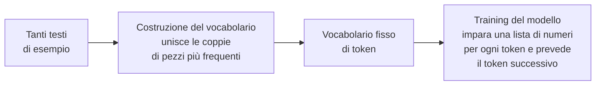
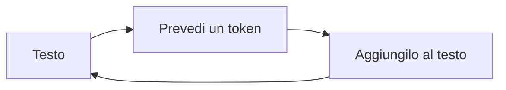
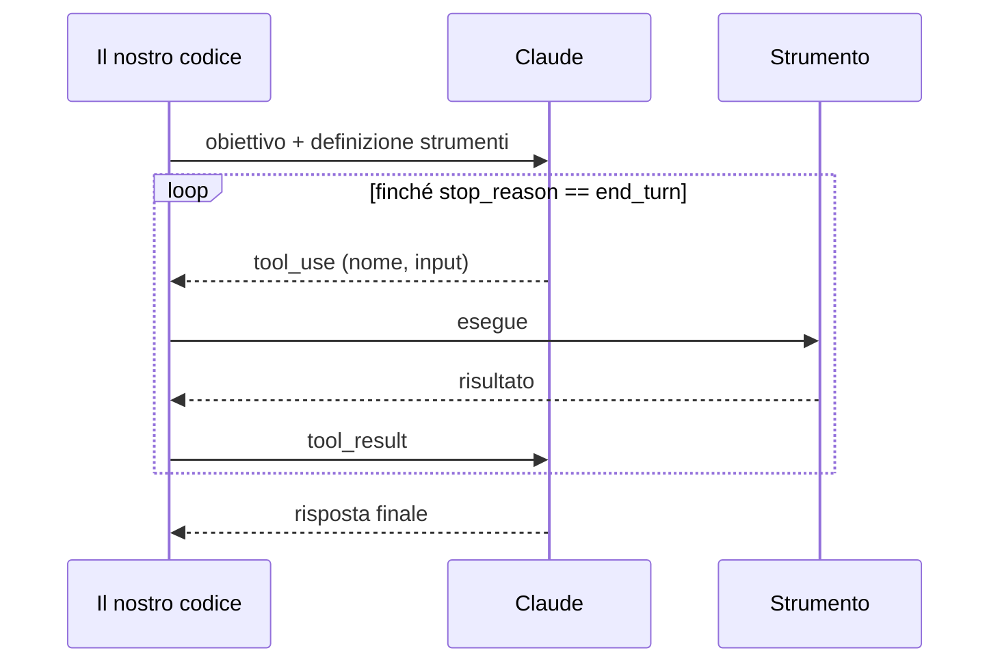
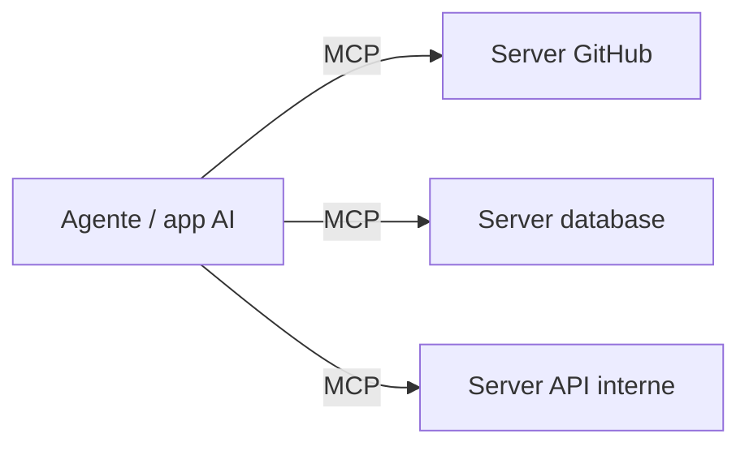
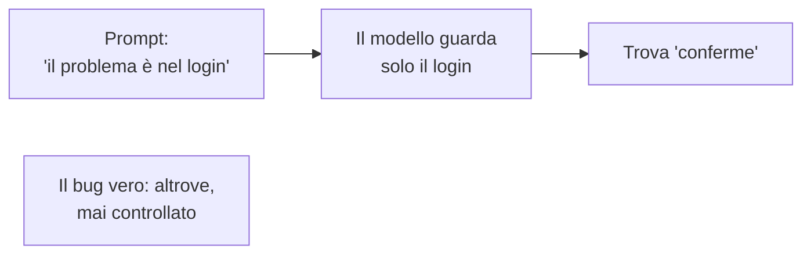
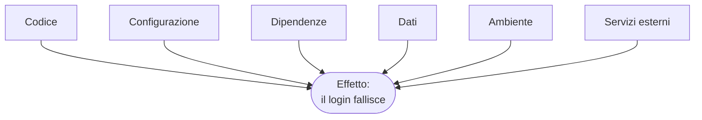

# Agentic AI

### Dall'assistente che risponde all'assistente che agisce

<span class="muted">Blexin · 2026</span>

Note: Obiettivo: capire cos'è un agente, come funziona dentro, quali trappole ha e vederne uno dal vivo.

---

## Di che cosa parleremo

1. Come ragiona un LLM, in breve
2. Dal chatbot all'agente
3. Le trappole: anche l'agente usa euristiche
4. Claude Code: un agente al lavoro
5. Demo dal vivo
6. Rischi, guardrail e responsabilità

---

# 1. Come ragiona un LLM

<span class="muted">Quello che serve sapere per capire un agente</span>

---

## Che cos'è un LLM

Un modello che prevede la parola successiva.

Tutto qui.

---

## Token: i pezzi del testo

Il modello non vede parole ma token.

`Il` · `gatto` · `dorm` · `e` · `sul` · `div` · `ano`

In media un token è circa ¾ di parola.

---

## Perché token e non parole?

<span class="muted">Un problema classico di NLP (Natural Language Processing)</span>

<div class="cols">
<div>

**Parole intere**

Vocabolario enorme: *dorme, dormiva, dormirebbe…*

Una parola mai vista (un nome, un refuso, un termine nuovo) è **sconosciuta**.

</div>
<div>

**Caratteri**

Pochi simboli, ma sequenze **lunghissime**.

Una singola lettera porta poco significato.

</div>
<div>

**Token** (pezzi di parola)

Le parole frequenti sono un token solo, le rare si **spezzano in pezzi noti**.

Nessuna parola è mai sconosciuta.

</div>
</div>

<span class="muted">Esempio indicativo: *smartworkando* → `smart` · `work` · `ando`. Tecnica più diffusa: BPE (Byte Pair Encoding).</span>

---

## Tokenizer e training: un legame stretto



- Ogni modello (Claude, ChatGPT…) ha **il suo tokenizer**, fissato **prima** del training: cambiarlo vuol dire riaddestrare il modello.
- Lo stesso testo dà un **numero di token diverso** da modello a modello: costi e limiti di contesto non si confrontano 1 a 1.
- Quello che era frequente nei testi di esempio (inglese, codice) costa meno token; l'italiano di solito ne richiede di più.

<span class="muted">Effetto curioso: il modello vede token, non lettere, per questo contare le lettere di una parola gli riesce male.</span>

---

## Prevedere il token successivo

*Il gatto dorme sul …*

| | |
|---|---|
| divano | 41% |
| letto | 23% |
| tetto | 12% |
| … | |

---

## Generare = ripetere



fino alla fine della risposta

---

## Temperatura

Bassa: sceglie sempre la parola più probabile.

Alta: osa di più, più creativa e più errori.

---

## Perché "temperatura"?

Un nome preso dalla fisica: freddo = ordinato e prevedibile, caldo = agitato e imprevedibile.

*Il gatto dorme sul …* <span class="muted">(stesse proporzioni della slide precedente, riportate su 100)</span>

| | Bassa (0,5) | Normale (1) | Alta (2) |
|---|---|---|---|
| divano | 71% | 54% | 44% |
| letto | 23% | 30% | 33% |
| tetto | 6% | 16% | 24% |

<span class="muted">Non c'entra il calore: è la manopola che regola quanto il modello rischia nella scelta della parola.</span>

---

## Allucinazioni

Una risposta convincente ma falsa.

---

## Perché succede

Il modello cerca ciò che è probabile,

non ciò che è vero.

---

## Finestra di contesto

La memoria di lavoro del modello.

<div class="cols">
<div><span class="tag">istruzioni</span></div>
<div><span class="tag">documenti</span></div>
<div><span class="tag">conversazione</span></div>
<div><span class="tag">risposta</span></div>
</div>

Quello che non ci sta, il modello non lo vede.

---

## Niente memoria tra conversazioni

Ogni chat riparte da zero.

Salvo strumenti che gli ridanno il contesto.

---

## Il contesto costa

| | |
|---|---|
| 1.000 token | 1 milione di confronti |
| 10.000 token | 100 milioni |
| 100.000 token | 10 miliardi |

Raddoppi il testo, quadruplichi il lavoro.

---

# 2. Dal chatbot all'agente

---

## Chatbot, workflow, agente

| | Chatbot | Workflow | Agente |
|---|---|---|---|
| Chi decide i passi? | — | Il nostro codice | Il modello |
| Strumenti | No | Sequenza fissa | Scelti al momento |
| Ciclo | Un turno | Predefinito | Fino all'obiettivo |
| Ideale per | Q&A, bozze | Processi ripetibili | Compiti aperti |

---

## La definizione

> Un **agente** è un LLM che **usa strumenti in un ciclo** per raggiungere un **obiettivo**, decidendo da solo il passo successivo.

<div class="cols">
<div><span class="tag">LLM</span><br>ragiona e decide</div>
<div><span class="tag">Strumenti</span><br>agiscono sul mondo</div>
<div><span class="tag">Ciclo</span><br>osserva → corregge</div>
</div>

---

## Anatomia di un agente


---

## Il ciclo: pensa, agisce, osserva



---

## Esempio

**"Quanti ordini aperti ci sono?"**

Pensa: serve una query sul DB

Agisce: `SELECT COUNT(*) …`

Osserva: 42

**"Ci sono 42 ordini aperti."**

---

## L'LLM non esegue niente

Scrive quale strumento usare.

Il programma lo esegue e gli ridà il risultato.

---

## Uno strumento è uno schema + una funzione

```python
@beta_tool
def aggregate_csv(name: str, group_by: str, value_column: str) -> str:
    """Somma una colonna numerica di un CSV, raggruppando per un'altra colonna.

    Args:
        name: nome del file CSV nella cartella di lavoro.
        group_by: colonna per cui raggruppare, es. regione.
        value_column: colonna numerica da sommare, es. ricavi_eur.
    """
    ...
```

Il modello vede solo **nome**, **descrizione** e **parametri**.<br>
<span class="muted">Scrivere buone descrizioni degli strumenti è il nuovo prompt engineering.</span>

---

## Pattern di progettazione

<div class="cols">
<div>

**Workflow**
- Catena di prompt
- Instradamento (routing)
- Parallelizzazione
- Valutatore–ottimizzatore

</div>
<div>

**Agenti**
- ReAct: ragiona → agisce → osserva
- Pianificazione + esecuzione
- Orchestratore + sotto-agenti
- Persona nel ciclo (human in the loop)

</div>
</div>

<span class="muted">Si parte dalla soluzione più semplice: una chiamata → un workflow → un agente.</span>

---

## Collegare gli strumenti: MCP



**Model Context Protocol**: uno standard aperto per collegare strumenti e dati a qualsiasi agente.<br>
<span class="muted">Si scrive l'integrazione una volta, la si usa da ogni client compatibile.</span>

---

# 3. Le trappole

### Anche l'agente usa euristiche

---

## Razionalità limitata

Non possiamo elaborare tutte le informazioni.

Non possiamo prevedere tutti i risultati.

<span class="muted">Herbert Simon – Nobel per l'economia 1978</span>

---

## Come si progetta un sistema AI?

<div class="cols">
<div><span class="tag">Risorse scarse</span><br>Un sistema AI lavora quasi sempre con dati limitati. Non vede tutto quello che succede.</div>
<div><span class="tag">Euristiche</span><br>Regole pratiche per decidere senza sapere tutto.</div>
<div><span class="tag">Satisficing</span><br>Una soluzione sufficiente invece della migliore.</div>
</div>

---

## Bug Fix

Una variante dell'ancoraggio: l'ancora è la nostra opinione.

> "Penso che il problema nel mio codice sia nella funzione di login, puoi controllare?"

Il modello rischia di concentrarsi lì e trovare "conferme", anche se il bug è altrove.

---

## Dove guarda il modello



---

## Ancoraggio + compiacenza

<div class="cols">
<div><span class="tag">Ancoraggio</span><br>parte dalla tua ipotesi</div>
<div><span class="tag">Compiacenza</span><br>tende a darti ragione</div>
</div>

Una risposta che conferma quello che pensavi già.

---

## L'ancora pericolosa non è quella assurda, che il modello smaschera.

È quella credibile, che sposta la risposta senza che nessuno se ne accorga.

---

## Lisca di pesce (Ishikawa)

Kaoru Ishikawa, controllo qualità, anni '60: prima tutte le cause possibili, poi si verifica.



La nostra ipotesi diventa una lisca tra le altre, non la risposta.

---

## Passo 1 – Estrazione

<div class="prompt">

Dal ticket seguente separa:

- FATTI OSSERVATI (cosa è successo, quando, a chi, messaggi d'errore)
- IPOTESI O VALUTAZIONI di chi ha scritto il ticket

Non proporre ancora cause né soluzioni.

[testo del ticket]

</div>

---

## Passo 2 – Diagnosi

<div class="prompt">

Partendo solo dai fatti osservati qui sotto, elenca almeno 4 cause possibili, indipendenti tra loro. Per ciascuna indica quale verifica concreta (log, query, test) la confermerebbe o la escluderebbe.
Solo alla fine confronta le cause con l'ipotesi del service desk.

[fatti estratti]<br>
[log / stack trace / diff dell'ultimo deploy]

</div>

---

## Euristica della familiarità

> "Ne ho già sentito parlare, quindi è migliore."

<div class="cols">
<div>

Prompt: "Serializza l'ordine in JSON."

```csharp
using Newtonsoft.Json;
JsonConvert.SerializeObject(ordine);
```

✓ La più vista in addestramento

</div>
<div>

Scegliamo quello che riconosciamo.

Nel codice: il modello propone la libreria che ha visto più spesso, non quella del progetto.

Il repo usa già System.Text.Json: ora ci sono due librerie per la stessa cosa.

</div>
</div>

---

## Satisficing

> "Va bene così."

<div class="cols">
<div>

✗ Test rosso<br>
NullReferenceException in CalcolaGiacenza

```csharp
try { CalcolaGiacenza(udc); }
catch { }
```

✓ Build verde: va bene così

</div>
<div>

Una soluzione sufficiente invece della migliore.

Nel codice: il test diventa verde, la causa resta.

La soluzione migliore, mai cercata: perché udc è null? La causa è nella query che la carica.

</div>
</div>

---

## Anche l'AI usa euristiche

Decide con regole pratiche, come noi.

E come noi eredita i pregiudizi dai dati.

---

# 4. Claude Code

### Un agente al lavoro sul codice

---

## Claude Code

Un agente che lavora sul codice e sui file.

Legge, cerca, modifica, esegue test.

<span class="muted">Le demo di oggi usano Claude Code in modalità non interattiva: `claude -p`.</span>

---

## Il contesto del progetto: CLAUDE.md

Un file che spiega all'agente il progetto.

- com'è fatto il progetto
- regole e convenzioni
- come si compila e si testa

---

## La cartella .claude

| | |
|---|---|
| `agents/` | agenti specializzati |
| `commands/` | comandi personalizzati |
| `skills/` | procedure riutilizzabili |
| `settings.json` | permessi e regole |

---

## Permessi

L'agente chiede prima di fare azioni importanti.

Siamo noi a decidere cosa può fare da solo.

<span class="muted">Nelle demo: `--tools Read,Glob,Grep --allowedTools "Read(./**)"`</span>

---

# Demo dal vivo

<span class="muted">make demo1 · make demo2 · make demo3</span>

---

## Demo 1 — una singola chiamata

```bash
claude -p "Qual è la differenza tra un chatbot e un agente AI?" \
       --tools ""
```

Un prompt entra, una risposta esce. **Nessuno strumento, nessun ciclo.**

---

## Demo 2 — l'uso di uno strumento

```bash
cd demo/store
claude -p "Sono il signor Rossi. Dove sono i miei ordini? Il database è orders.json." \
       --tools Read --allowedTools "Read(./**)"
```

Claude non vede i dati: **chiede** lo strumento `Read`, il programma lo **esegue**
e gli ridà il risultato.<br>
<span class="muted">`Read(./**)`: le letture fuori da questa cartella vengono negate.</span>

---

## Dietro le quinte — il ciclo nel codice

```python
while True:
    response = client.messages.create(..., tools=TOOLS, messages=messages)
    tool_calls = [b for b in response.content if b.type == "tool_use"]
    if not tool_calls:
        break                                   # risposta finale
    messages.append({"role": "assistant", "content": response.content})
    messages.append({"role": "user", "content": [
        {"type": "tool_result", "tool_use_id": c.id, "content": run(c)}
        for c in tool_calls
    ]})
```

È quello che Claude Code (o il tool runner dell'SDK) fa per noi.

---

## Demo 3 — un agente autonomo

```bash
cd demo/workspace
claude -p "Cerca in questa cartella una richiesta del direttore commerciale e portala a termine." \
       --tools Read,Glob,Grep --allowedTools "Read(./**)" Glob Grep \
       --output-format stream-json --verbose
```

L'agente trova la richiesta, legge i dati, calcola i totali e prepara il report.<br>
<span class="muted">Solo lettura per scelta: il nostro codice salva report.md solo dopo l'approvazione di una persona.</span>

---

# 5. Rischi e responsabilità

---

## Rischi e guardrail

| Rischio | Mitigazione |
|---|---|
| Azioni sbagliate o distruttive | Strumenti col minimo privilegio, sandbox, approvazioni |
| Prompt injection dai dati | Trattare l'output degli strumenti come dati, non istruzioni |
| Costi e cicli senza fine | Limiti di turni, budget, livello di "effort" |
| Numeri inventati | Strumenti deterministici per i calcoli esatti |
| Dati che escono dall'azienda | Scegliere cosa entra nel contesto, policy chiare |
| Difficile da capire cosa è successo | Tracciare ogni chiamata a strumento, valutazioni (eval) |

---

## Quando costruire un agente?

- Il compito è **complesso** e difficile da specificare in anticipo?
- Il risultato **vale** il costo e il tempo in più?
- Il modello è **capace** di questo tipo di compito?
- Gli **errori si possono intercettare** e correggere?

<span class="muted">Se anche una sola risposta è "no": una singola chiamata o un workflow.</span>

---

## I limiti

Sbaglia, a volte con sicurezza.

Costa: ogni token si paga.

I dati che gli diamo escono dall'azienda.

---

## Cosa non delegare

Decisioni e responsabilità.

Rilasci senza controllo.

Dati dei clienti senza verifica.

---

## La responsabilità resta nostra

L'agente propone, la persona decide.

---

## Da dove iniziare

1. Scegliere un compito ripetitivo e con più passaggi
2. Esporre le API esistenti come strumenti (o server MCP)
3. All'inizio, una persona approva ogni azione
4. Misurare con un piccolo insieme di casi di prova, poi aumentare l'autonomia

---

> "Tutti i modelli sono sbagliati, ma alcuni sono utili."

<span class="muted">— George E. P. Box</span>

---

# Grazie

### Domande?

<span class="muted">Codice e slide: github.com/janmaru/ai-agentic</span>
