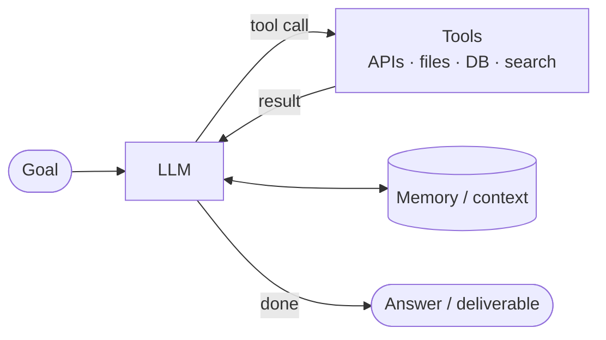
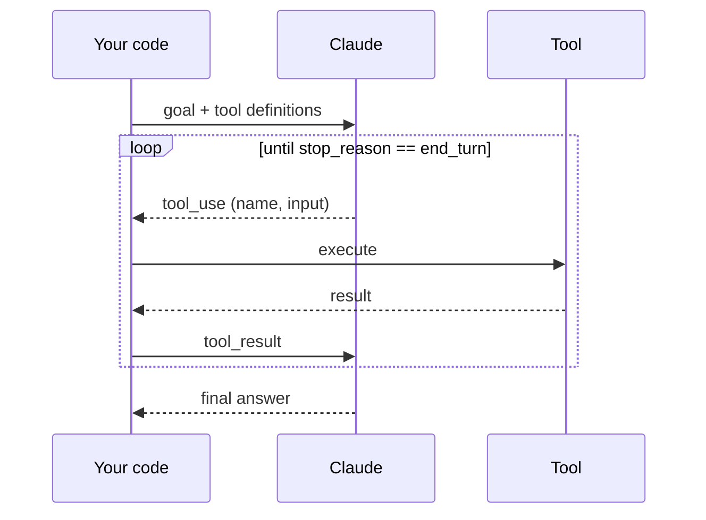
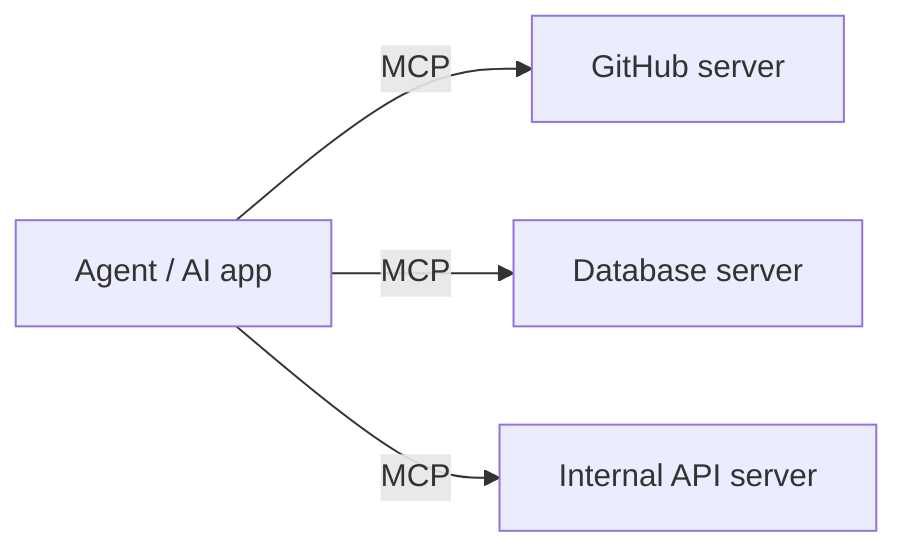

# Agentic AI

### From chatbots to systems that act

<span class="muted">Blexin · 2026</span>

Note: Welcome. Goal of the talk: understand what an agent is, how it works under the hood, and see one live.

---

## Agenda

1. From chatbots to agents
2. Anatomy of an agent
3. Design patterns
4. Live demo
5. Risks and guardrails
6. Where to start

---

## From chatbots to agents

| | Chatbot | Workflow | Agent |
|---|---|---|---|
| Who decides the steps? | — | Your code | The model |
| Tools | No | Fixed sequence | Chosen dynamically |
| Loop | One turn | Predefined | Until goal is met |
| Best for | Q&A, drafting | Repeatable pipelines | Open-ended tasks |

Note: Key message: an agent is an LLM that uses tools in a loop, deciding its own next step.

---

## The definition we will use

> An **agent** is an LLM that **uses tools in a loop** to reach a **goal**, deciding on its own what to do next.

<div class="cols">
<div><span class="tag">LLM</span><br>reasons and plans</div>
<div><span class="tag">Tools</span><br>act on the world</div>
<div><span class="tag">Loop</span><br>observe → adjust</div>
</div>

---

## Anatomy of an agent



---

## The agent loop



---

## A tool is just a schema + a function

```python
@beta_tool
def aggregate_csv(name: str, group_by: str, value_column: str) -> str:
    """Sum a numeric column of a CSV file, grouped by another column.

    Args:
        name: CSV file name in the workspace.
        group_by: Column to group rows by, e.g. region.
        value_column: Numeric column to sum, e.g. revenue_eur.
    """
    ...
```

The model sees only the **name**, **description** and **parameters**.<br>
<span class="muted">Good tool descriptions are the new prompt engineering.</span>

---

## Design patterns

<div class="cols">
<div>

**Workflows**
- Prompt chaining
- Routing
- Parallelization
- Evaluator–optimizer

</div>
<div>

**Agents**
- ReAct: reason → act → observe
- Planning + execution
- Orchestrator + sub-agents
- Human in the loop

</div>
</div>

<span class="muted">Start with the simplest thing that works: one call → workflow → agent.</span>

---

## Connecting tools: MCP



**Model Context Protocol**: one open standard to plug tools and data into any agent.<br>
<span class="muted">Write the integration once, use it from every MCP-compatible client.</span>

---

# Live demo

<span class="muted">make demo1 · make demo2 · make demo3</span>

---

## Demo 1 — a single call

```python
response = client.beta.messages.create(
    model="claude-opus-5-5",
    max_tokens=16000,
    messages=[{"role": "user", "content": PROMPT}],
)
```

One prompt in, one answer out. **No tools, no loop.**

---

## Demo 2 — tool use, step by step

```python
while True:
    response = client.beta.messages.create(..., tools=TOOLS, messages=messages)
    tool_calls = [b for b in response.content if b.type == "tool_use"]
    if not tool_calls:
        break                                   # final answer
    messages.append({"role": "assistant", "content": response.content})
    messages.append({"role": "user", "content": [
        {"type": "tool_result", "tool_use_id": c.id, "content": run(c)}
        for c in tool_calls
    ]})
```

The model **asks**, your code **executes**.

---

## Demo 3 — an autonomous agent

```python
runner = client.beta.messages.tool_runner(
    model="claude-opus-5-5",
    system=SYSTEM,
    tools=[list_files, read_file, aggregate_csv, write_file],
    messages=[{"role": "user", "content": GOAL}],
)
for message in runner:   # the SDK runs the loop
    show(message)
```

Goal: *"Check the workspace for a request from the sales director and complete it."*<br>
<span class="muted">The agent finds the brief, computes totals, drafts a report and asks before writing.</span>

---

## Risks and guardrails

| Risk | Mitigation |
|---|---|
| Wrong or destructive actions | Least-privilege tools, sandboxing, approval gates |
| Prompt injection via tool data | Treat tool output as data, not instructions |
| Runaway cost / loops | Turn limits, task budgets, effort settings |
| Hallucinated numbers | Deterministic tools for exact computation |
| Hard to debug | Tracing, logging every tool call, evals |

---

## When should you build an agent?

- Is the task **complex** and hard to specify in advance?
- Is the outcome **valuable** enough to justify cost and latency?
- Is the model **capable** of this kind of task?
- Can **errors be caught** and recovered from?

<span class="muted">If any answer is "no", use a single call or a workflow.</span>

---

## Where to start

1. Pick one repetitive, multi-step task
2. Wrap your existing APIs as tools (or MCP servers)
3. Start with a human approving every action
4. Measure with a small eval set, then widen autonomy

---

# Thank you

### Questions?

<span class="muted">Code and slides: this repository</span>
